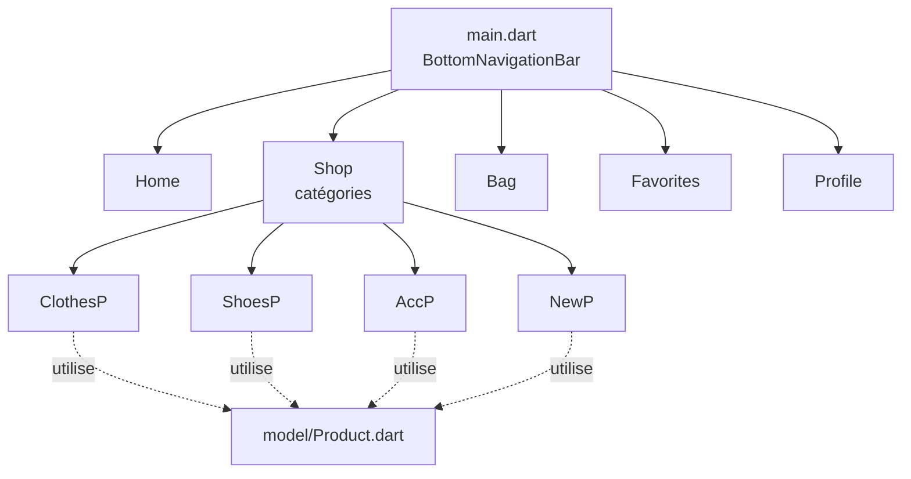

# Flutter E-commerce App — front-end mobile

Front-end d'une **application mobile e-commerce** de vêtements développée avec **Flutter** : navigation par onglets, catalogue par catégories et grille de produits.


---

## Aperçu du catalogue

| New | Clothes | Shoes | Accessories |
|:---:|:---:|:---:|:---:|
|  |  |  |  |

## Fonctionnalités

- **Barre de navigation inférieure** à 5 onglets : Home, Shop, Bag, Favorites, Profile
- **Écran Shop** : liste des catégories (New, Clothes, Shoes, Accessories) avec visuels
- **Écrans catégories** : grille de produits responsive (`GridView.builder`) avec cartes arrondies, ombre, image, nom et prix
- **Modèle `Product`** (nom, prix, image) séparé de l'interface
- Navigation entre écrans avec `Navigator` / `MaterialPageRoute`

## Architecture



```
lib/
├── main.dart          # Point d'entrée + navigation par onglets
├── Home.dart          # Accueil
├── Shop.dart          # Liste des catégories
├── NewP.dart          # Nouveautés
├── ClothesP.dart      # Vêtements (grille produits)
├── ShoesP.dart        # Chaussures
├── AccP.dart          # Accessoires
├── Bag.dart           # Panier
├── Fav.dart           # Favoris
├── Profile.dart       # Profil
└── model/
    └── Product.dart   # Modèle produit
images examen/         # Visuels produits et catégories
```

## Lancer le projet

**Prérequis :** [Flutter SDK](https://docs.flutter.dev/get-started/install) 3.x (Dart ≥ 3.1)

```bash
git clone https://github.com/saadmekraz/Flutter-ecom-app.git
cd Flutter-ecom-app
flutter pub get
flutter run
```

## Feuille de route

- [x] Navigation par onglets et catalogue par catégories
- [x] Grille de produits avec modèle de données
- [ ] Panier fonctionnel (ajout, quantité, total) avec `Provider`
- [ ] Favoris et page produit détaillée
- [ ] Écrans Home et Profile
- [ ] Données produits depuis une API ou Firebase

## Auteur

**Saad Mekraz** — [GitHub](https://github.com/saadmekraz)
